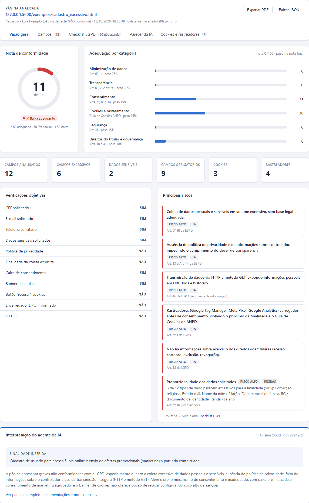
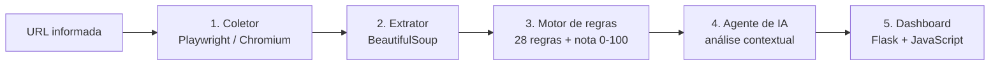
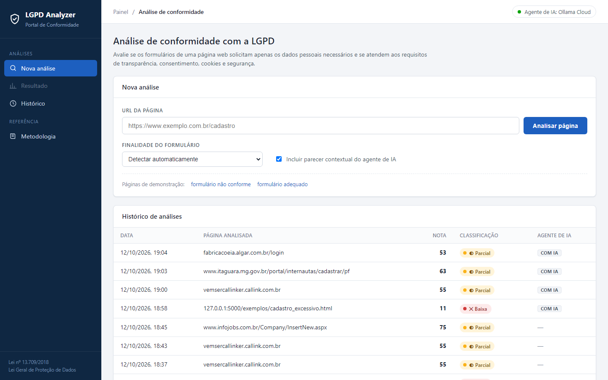
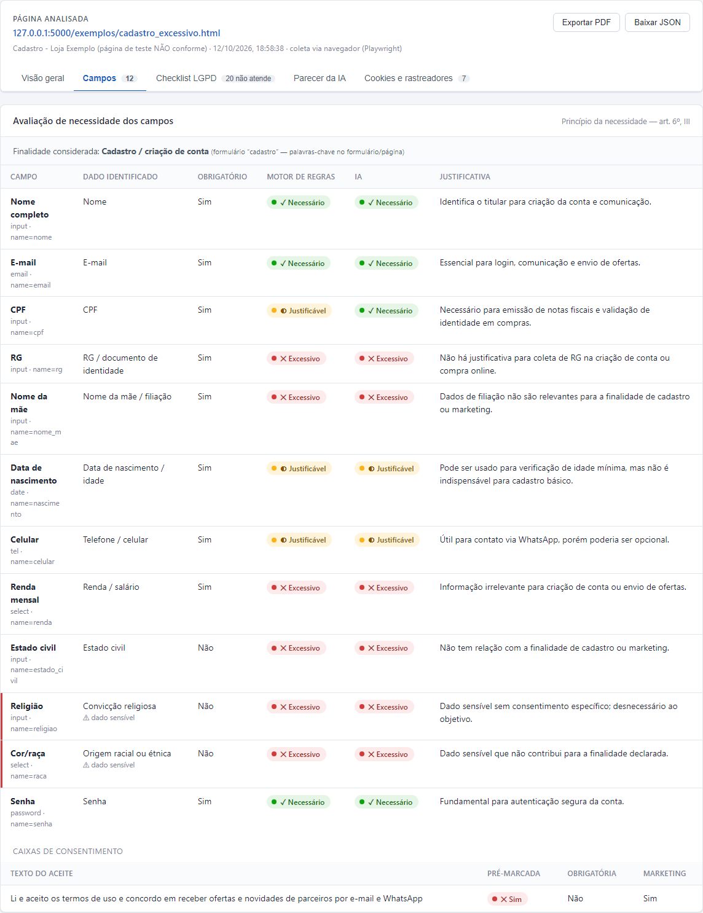
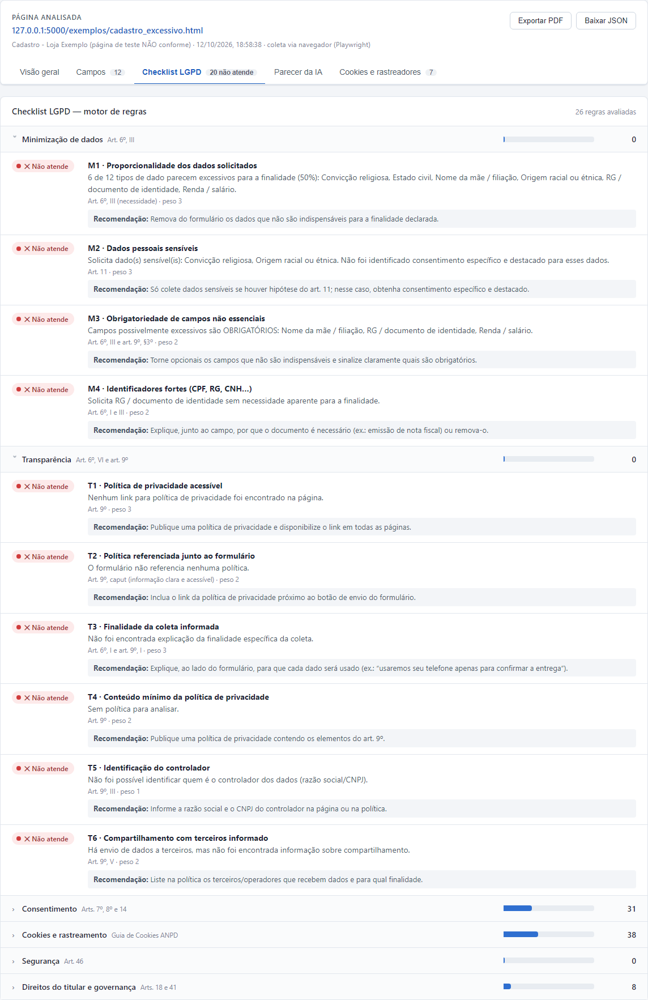
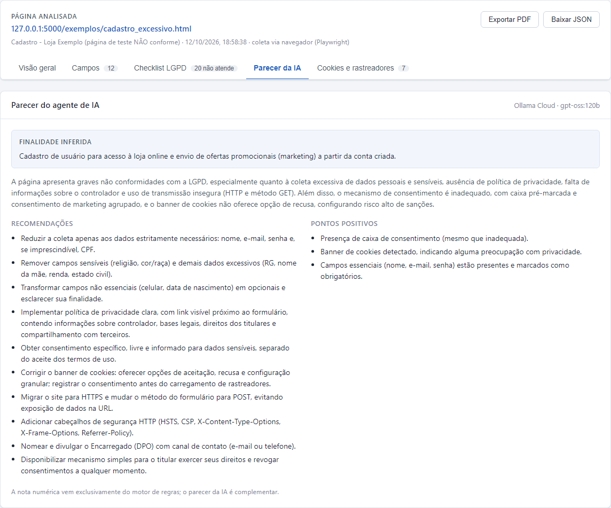

# 🔎 LGPD Web Analyzer

**Ferramenta web para avaliação automatizada da conformidade de formulários online com a Lei Geral de Proteção de Dados (LGPD — Lei nº 13.709/2018).**

O usuário informa a URL de uma página de cadastro (ou qualquer outro formulário) e o sistema faz uma
varredura completa: identifica todos os dados pessoais solicitados, avalia se cada um é **necessário**
ou está sendo **pedido em excesso** (princípio da necessidade, art. 6º, III), verifica transparência,
consentimento, cookies, segurança e direitos do titular, e apresenta o resultado em um dashboard com
nota de 0 a 100, riscos e recomendações.

> Projeto desenvolvido como Trabalho de Conclusão de Curso (TCC) da pós-graduação em Engenharia de Software da USP/Esalq.



---

## Sumário

- [Problema e motivação](#problema-e-motivação)
- [Funcionalidades](#funcionalidades)
- [Como funciona](#como-funciona)
- [Motor de regras](#motor-de-regras)
- [Agente de IA](#agente-de-ia)
- [Telas](#telas)
- [Como executar](#como-executar)
- [Estrutura do projeto](#estrutura-do-projeto)
- [Tecnologias](#tecnologias)
- [Limitações](#limitações)

---

## Problema e motivação

A LGPD determina que o tratamento de dados pessoais deve se limitar ao **mínimo necessário** para a
finalidade informada ao titular. Na prática, muitos formulários web solicitam dados sem justificativa
(CPF para receber uma newsletter, nome da mãe e renda para criar uma conta, religião e raça em
cadastros comuns), não informam a finalidade da coleta, usam caixas de consentimento pré-marcadas ou
carregam rastreadores de publicidade antes de qualquer autorização.

Verificar isso manualmente é trabalhoso e subjetivo. Este projeto propõe uma ferramenta que
**automatiza a coleta de evidências** e combina **regras objetivas** (reprodutíveis e vinculadas aos
artigos da lei) com **análise contextual por inteligência artificial**.

## Funcionalidades

- **Varredura automática da página** com navegador real (executa JavaScript, captura cookies e requisições a terceiros).
- **Identificação de 36 tipos de dados pessoais**, incluindo os 7 dados sensíveis do art. 5º, II (saúde, religião, origem racial, biometria etc.).
- **Detecção da finalidade do formulário** (cadastro, login, contato, newsletter, compra, candidatura a vaga, serviço financeiro, saúde, evento) — ou escolha manual.
- **Classificação de cada campo** como *necessário*, *justificável* ou *excessivo* para a finalidade.
- **28 regras de conformidade** em 6 categorias, cada uma vinculada a um artigo da LGPD ou ao Guia de Cookies da ANPD.
- **Leitura da política de privacidade**, verificando os 11 tópicos esperados pelo art. 9º.
- **Análise de cookies e rastreadores** (Google Analytics, Meta Pixel, TikTok, Hotjar e outros ~30), banner de cookies e opção de recusa.
- **Parecer do agente de IA** com finalidade inferida, segunda opinião sobre cada campo, riscos e recomendações.
- **Dashboard** com nota, gráfico por categoria, indicadores, checklist detalhado e recomendações.
- **Histórico** de análises e **exportação** em PDF e JSON.

## Como funciona



| Etapa | Arquivo | O que faz |
|---|---|---|
| **1. Coleta** | [`lgpd/coletor.py`](lgpd/coletor.py) | Abre a página em um navegador sem interface (headless), executa o JavaScript e captura HTML, cookies, cabeçalhos HTTP e todas as requisições feitas a terceiros. Se o navegador não estiver disponível, faz uma coleta simples via HTTP. |
| **2. Extração** | [`lgpd/extrator.py`](lgpd/extrator.py) | Localiza formulários e campos e descobre o rótulo de cada um (label, aria-label, placeholder, texto próximo). Identifica links de política de privacidade/termos/cookies, o banner de cookies e seus botões, rastreadores e plataformas de consentimento. |
| **Base de conhecimento** | [`lgpd/catalogo.py`](lgpd/catalogo.py) | Catálogo declarativo: tipos de dado pessoal, finalidades de formulário e os dados que cada uma justifica, rastreadores conhecidos e tópicos obrigatórios de uma política de privacidade. |
| **3. Regras** | [`lgpd/regras.py`](lgpd/regras.py) | Classifica cada campo conforme a finalidade, executa as regras de conformidade e calcula a nota. |
| **4. IA** | [`lgpd/agente_ia.py`](lgpd/agente_ia.py) | Envia os achados a um modelo de linguagem, que faz a interpretação contextual e devolve um parecer estruturado (JSON). |
| **5. Dashboard** | [`app.py`](app.py), [`templates/`](templates), [`static/`](static) | Servidor web e interface do portal. |

## Motor de regras

Cada regra resulta em **atende (1,0)**, **parcial (0,5)**, **não atende (0,0)** ou **não se aplica**
(desconsiderada no cálculo). A nota de cada categoria é a média ponderada de suas regras e a **nota
final** é a média ponderada das categorias. Como a nota vem exclusivamente do motor de regras, ela é
**determinística**: a mesma página sempre recebe a mesma nota.

| Categoria | Peso | Base legal | Regras |
|---|:-:|---|---|
| **Minimização de dados** | 25% | Art. 6º, III | **M1** proporcionalidade dos dados solicitados · **M2** dados sensíveis sem consentimento específico (art. 11) · **M3** campos não essenciais marcados como obrigatórios · **M4** identificadores fortes (CPF, RG, CNH) sem justificativa |
| **Transparência** | 20% | Art. 6º, VI e art. 9º | **T1** política de privacidade acessível · **T2** política referenciada junto ao formulário · **T3** finalidade da coleta informada · **T4** conteúdo mínimo da política (11 tópicos) · **T5** identificação do controlador (razão social/CNPJ) · **T6** compartilhamento com terceiros informado |
| **Consentimento** | 15% | Arts. 7º, 8º e 14 | **C1** mecanismo de consentimento ou ciência · **C2** caixas de aceite pré-marcadas · **C3** consentimento granular (marketing separado dos termos) · **C4** tratamento de dados de crianças e adolescentes |
| **Cookies e rastreamento** | 15% | Guia de Cookies da ANPD | **K1** banner de cookies · **K2** opção de recusar · **K3** rastreadores carregados antes do consentimento · **K4** cookies de terceiros · **K5** validade superior a 13 meses · **K6** política de cookies |
| **Segurança** | 15% | Art. 46 | **S1** HTTPS · **S2** envio seguro do formulário (POST/HTTPS, sem dados na URL) · **S3** cabeçalhos de segurança HTTP · **S4** conteúdo misto · **S5** atributo Secure nos cookies |
| **Direitos do titular e governança** | 10% | Arts. 18 e 41 | **D1** encarregado (DPO) identificado · **D2** canal para exercício de direitos · **D3** informação sobre revogação do consentimento |

**Faixas de classificação:** ≥ 80 *adequado* · 50 a 79 *adequação parcial* · abaixo de 50 *baixa adequação*.

### Avaliação de necessidade dos campos

1. O **tipo de dado** de cada campo é identificado pelo atributo `autocomplete`, pelo `type` do input e por expressões regulares aplicadas ao rótulo, nome e placeholder.
2. A **finalidade** do formulário é detectada por palavras-chave no formulário e na página (ou definida manualmente pelo usuário).
3. Para cada finalidade, o catálogo define quais dados são **necessários** e quais são **justificáveis**; qualquer outro dado é considerado potencialmente **excessivo**.
4. Dados sensíveis e identificadores fortes pedidos sem necessidade recebem **severidade alta**.

Exemplo — finalidade *cadastro / criação de conta*:

| Dado | Classificação |
|---|---|
| Nome, e-mail, senha | ✅ Necessário |
| Telefone, data de nascimento, CPF, CEP | 🟡 Justificável (idealmente opcional e com finalidade informada) |
| RG, nome da mãe, renda, estado civil | 🔴 Excessivo |
| Religião, origem racial, dados de saúde | 🔴 Excessivo + dado sensível (art. 11) |

## Agente de IA

O motor de regras é objetivo, mas não entende contexto. O agente de IA complementa a análise:

> **Interpretação inteligente** — analisa os textos e as evidências, considera o contexto, identifica
> possíveis lacunas de transparência, explica os achados e sugere melhorias.

Ele recebe os campos, textos do formulário, trecho da política de privacidade, cookies, rastreadores e
o resultado de todas as regras, e devolve:

- a **finalidade real inferida** da coleta;
- uma **segunda opinião** sobre a necessidade de cada campo (exibida ao lado da classificação do motor de regras);
- **riscos** com o artigo correspondente da LGPD;
- **recomendações** práticas e **pontos positivos**.

A nota numérica **não** depende da IA — o parecer é complementar. O agente funciona com qualquer um dos
provedores abaixo, configurados no arquivo `.env` (nenhum exige instalação local):

| Provedor | `LGPD_IA_PROVEDOR` | Chave gratuita | Modelo padrão |
|---|---|---|---|
| Ollama Cloud | `ollama` | https://ollama.com/settings/keys | `gpt-oss:120b` |
| Groq | `groq` | https://console.groq.com/keys | `openai/gpt-oss-120b` |
| Google Gemini | `gemini` | https://aistudio.google.com/apikey | `gemini-flash-latest` |
| OpenRouter | `openrouter` | https://openrouter.ai/keys | `openai/gpt-oss-120b:free` |
| Claude (Anthropic) | `anthropic` | pago — https://console.anthropic.com | `claude-opus-5-5` |

Sem chave configurada, o sistema funciona normalmente, apenas sem o parecer da IA.

## Telas

**Tela inicial** — informe a URL, a finalidade (opcional) e se deseja o parecer da IA:



**Avaliação dos campos** — classificação do motor de regras e da IA lado a lado:



**Checklist LGPD** — cada regra com status, artigo e recomendação:



**Parecer do agente de IA:**



## Como executar

**Pré-requisito:** [Python 3.10+](https://www.python.org/downloads/).

### Windows (mais fácil)

Dê dois cliques em **`iniciar.bat`**. Na primeira execução ele instala as dependências; depois inicia
o servidor e abre o navegador em http://127.0.0.1:5000.

### Manualmente

```bash
pip install -r requirements.txt
```

```bash
python -m playwright install chromium
```

```bash
python app.py
```

Acesse http://127.0.0.1:5000. Na tela inicial há links para duas **páginas de demonstração** incluídas
no projeto: um formulário propositalmente não conforme e um formulário adequado.

### Configurar o agente de IA (opcional)

1. Copie `.env.example` para `.env`.
2. Escolha o provedor em `LGPD_IA_PROVEDOR` e cole a chave correspondente.
3. Reinicie o servidor.

> ⚠️ O arquivo `.env` contém sua chave e **não deve ser publicado** — ele já está no `.gitignore`.

## Estrutura do projeto

```
├── app.py                  # servidor web (Flask) e rotas da API
├── iniciar.bat             # atalho para iniciar no Windows
├── requirements.txt
├── .env.example            # modelo de configuração do agente de IA
├── lgpd/
│   ├── coletor.py          # 1. acesso à página (Playwright / requests)
│   ├── extrator.py         # 2. extração de campos, links, banner, rastreadores
│   ├── catalogo.py         #    base de conhecimento (tipos de dado, finalidades...)
│   ├── regras.py           # 3. motor de regras e cálculo da nota
│   ├── agente_ia.py        # 4. agente de IA (Ollama, Groq, Gemini, OpenRouter, Claude)
│   └── analisador.py       #    orquestra o fluxo e salva o histórico
├── templates/index.html    # 5. portal (HTML)
├── static/                 #    estilos e JavaScript do dashboard
├── exemplos/               # páginas de demonstração (não conforme / adequada)
└── docs/img/               # capturas de tela
```

### API

| Método | Rota | Descrição |
|---|---|---|
| `POST` | `/api/analisar` | Corpo: `{"url": "...", "finalidade": "cadastro", "usar_ia": true}` — retorna o relatório completo em JSON |
| `GET` | `/api/historico` | Lista as análises realizadas |
| `GET` | `/api/historico/<id>` | Retorna uma análise do histórico |

## Tecnologias

- **Python** · **Flask** — servidor web e API
- **Playwright (Chromium)** — navegação automatizada e captura de cookies/requisições
- **BeautifulSoup** — extração de conteúdo HTML
- **Modelos de linguagem** (Ollama Cloud, Groq, Gemini, OpenRouter ou Claude) — análise contextual
- **HTML, CSS e JavaScript** puros — interface do portal

## Limitações

- A análise ocorre no **primeiro acesso, sem interação**: a ferramenta não clica em "aceitar", não percorre etapas seguintes de formulários com várias páginas nem acessa áreas que exigem login.
- A identificação de campos e da finalidade usa palavras-chave e pode errar em rótulos ambíguos — por isso a IA oferece uma segunda opinião e a finalidade pode ser definida manualmente.
- Banners de cookies carregados em iframes ou shadow DOM podem não ter seus botões verificados.
- Parte da conformidade com a LGPD envolve processos internos da organização, que não são visíveis na página.
- Ao executar localmente (`127.0.0.1`), as regras de HTTPS não são atendidas — comportamento esperado.

> **Aviso:** esta é uma ferramenta de apoio técnico e acadêmico. Os resultados são indicativos e
> **não substituem uma avaliação jurídica**.
